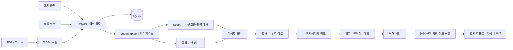
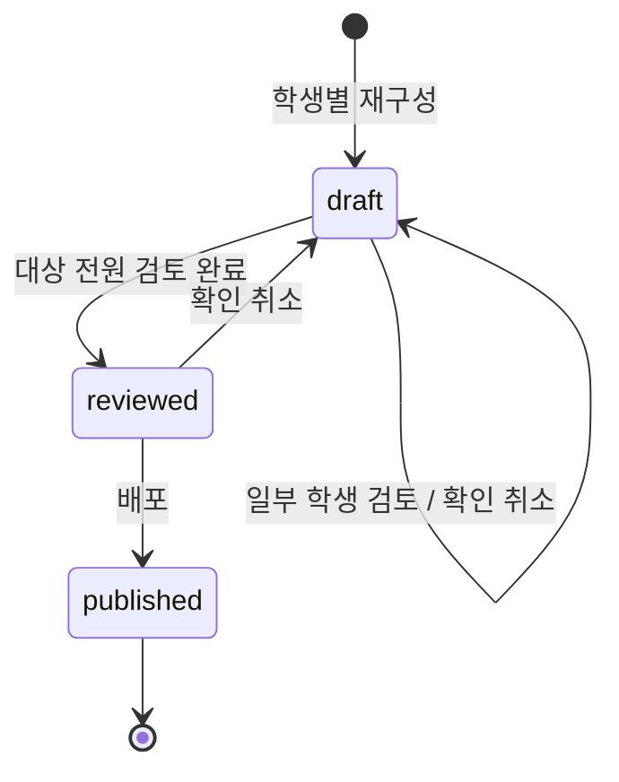

# 이음 아키텍처

## 설계 기준

설계안의 **수업 전 준비 → 수업 중 지원 → 수업 후 확인**을 중심으로 구성했습니다. 교사와 학생은 같은 자료를 바라보되 API가 역할과 수신 학생을 확인합니다. 화면에서 메뉴를 숨기는 것만으로 권한을 구현하지 않습니다.

가칭은 ‘이음’입니다. 계단 로고와 한국어 UI는 외부 이미지·폰트 없이 동작합니다. React/TypeScript/Vite, FastAPI/Pydantic, SQLite를 사용해 외부 서비스 없이 전체 흐름을 실행하고 어댑터와 저장 계층을 확장할 수 있게 했습니다.



## 자료 상태와 검토



- `targets`: 수신 학생 목록.
- `variants`: 학생 ID별 쉬운 글·교과어·언어·단계·개념 카드.
- `reviewed`: 교사가 확인한 학생 목록. 대상 전원과 일치해야 배포됩니다.
- 글·번역 수정과 확인은 함께 저장됩니다. 화면에 미저장 수정이 있으면 배포 버튼을 비활성화합니다.
- 배포본은 수정할 수 없습니다. 후속 버전 관리로 수업·평가 근거를 보존해야 합니다.
- 학생에게는 자신의 수신 자료와 **자신의 variant만** 전달됩니다.

교사 확인은 번역이 객관적으로 검증되었다는 보증이 아닙니다.

L1 자료는 `variants[student_id].reconstruction`에 문장별 근거·어휘 위계·시각 자료·지원 판단을 저장합니다. 학생 응답에서는 이 교사용 필드를 제거합니다. 교사의 구조화 수정에서 `text/terms/visuals`를 다시 계산해 기존 읽기 화면과 호환합니다. 모델 응답의 승인 필드는 신뢰하지 않으며, 중간 저장은 검토 완료 상태를 해제합니다. 상세 흐름은 [L1 통합 안내](teacher-l1-integration.md)를 참고하세요.

L2 오역 탐지는 자료 메뉴 안의 독립 검토 흐름입니다. PDF·텍스트 또는 저장된 학생별 자료를 입력받아 Solar가 문맥·근거를 제안하고 서버가 실제 인용·대역 비교·중복 근거·건수를 검사합니다. 교과·단원 근거가 부족하면 결과를 보류하며 교사 선택 후 재실행할 수 있습니다. 검토 당시 본문·설정·결과는 `translation_reviews`에 저장하고 기존 자료 상태는 바꾸지 않습니다. 이미지 대역표는 L1·L2 공통 참고 자료이며 검수 전이므로 자동 확정 근거로 사용하지 않습니다. [L2 통합 안내](teacher-l2-integration.md)에 분류 규칙과 한계를 정리했습니다.

## 에이전트 교체 지점

`backend/app/agents.py`:

```python
class LearningAgent(Protocol):
    def reconstruct(self, source: str, level: int, language: str, modes: list[str]) -> dict: ...
    def questions(self, source: str) -> list[dict]: ...
```

`IEUM_AGENT_PROVIDER=demo`는 `DemoLearningAgent`, `solar`는 `backend/app/solar_agent.py`의 `SolarLearningAgent`를 선택합니다. `create_app(..., learning_agent=...)`로 모의 어댑터도 주입할 수 있습니다. 루트 `.env`는 Python 서버가 자동 로드하며, API 키는 서버에만 둡니다.

교사용 L1·L2는 각각 `reconstruct_l1(request)`·`analyze_translation(request)`를 통해 같은 Solar 어댑터의 구조화 호출을 사용합니다. 데모 구현은 각 워크플로 모듈에서 처리하며 L2 데모는 명시적인 용어 병기만 비교합니다.

Solar는 원문·읽기 수준·대상 언어·지원 방식으로 구조화 JSON을 요청합니다. 응답 스키마를 검증한 뒤 저장하며, 인증·한도·통신·형식 오류를 한국어 메시지로 변환합니다. HTTP 응답 원문·키·모델 검증 입력은 클라이언트 오류에 노출하지 않습니다. 연결 10초/네트워크 작업 90초의 타임아웃을 적용하며 자동 재시도는 하지 않습니다. 네트워크 요청 중 DB 연결은 열어 두지 않습니다.

다음 품질 개선 파이프라인은 **후속 구현**입니다.

1. 원문·언어·영역별 수준을 구조화합니다.
2. 원문에 근거한 쉬운 글과 교과어를 생성합니다.
3. 의미 보존·수준 적합성·대역을 검사합니다.
4. 실패 항목을 제한된 횟수로 재생성합니다(Evaluator–Optimizer).
5. 근거와 검토 필요 항목을 교사에게 제공합니다. AI가 검토 완료·배포를 결정하지 않습니다.

입력 문서의 명령문은 자료 데이터로 취급하도록 시스템 지시와 분리해 전달합니다. 구조 검사만으로 의미 정확성을 보장하지 않으므로 교사 검토가 필요합니다. 비용 총량 제한·의미 검증은 후속 범위입니다.

PDF는 `pypdf`로 텍스트를 추출합니다. 스캔본은 오류와 직접 입력 안내를 반환합니다. OCR 성공이나 이미지 생성을 가장하지 않습니다.

## 평가와 해석

데모는 정치 단원 예제 원문과 공백 제외 내용이 일치할 때 고정 문항을 사용합니다. Solar는 제공 원문에서 2개 개념을 골라 일반/언어 부담 감소 문항을 각각 생성합니다(총 4개). 서버에서 개념별 쌍·보기 3개·정수 정답 0~2를 검사합니다. 별도의 문항 승인 상태는 아직 없습니다.

- 문항 조회에서 `answer`·`explanation`을 제외합니다.
- 전 문항에 유효한 정수 답을 제출해야 채점됩니다.
- 제출 후 정답·해설을 제공합니다. 재학습용이며 부정행위 방지 시험 시스템은 아닙니다.
- 응답 패턴으로 언어 지원 우선 관찰 / 개념·언어 동시 관찰 / 이번 문항 이해 / 추가 관찰을 제안합니다.
- 응답 없는 학생에게는 **근거 없음**을 표시합니다.
- 생활·학습 한국어 격차만으로 인지 능력이나 개념 이해를 판정하지 않습니다.
- 4문항 규칙은 타당도가 검증되지 않았습니다. 난이도·배경 지식·상황 익숙함도 영향을 줍니다.

기존 자가 점검은 **1~4단계**입니다. 교사용 L1 프로필은 첨부 진단의 **1~6단계**를 별도로 보존하며 서로 변환하지 않습니다. 상세 재구성 규칙은 첨부 JSON을 사용하고, 빈 어휘 사전에서 위계·수준을 추정하지 않습니다.

## 데이터 모델

| 테이블                | 내용                                                  |
| --------------------- | ----------------------------------------------------- |
| `students`            | 합성 이름·언어·학년·영역별 단계·생활 단계·기록 출처   |
| `l1_profiles`         | 교사가 학생별로 연결한 별도 L1 진단 프로필·갱신 시각  |
| `sessions`            | 무작위 토큰·역할·학생 ID·발급 시각(1일 만료)          |
| `materials`           | 원문·대상·지원 방식·variant·검토·상태                 |
| `translation_reviews` | 교사 전용 검토 당시 본문·설정·결과·선택적 원자료 연결 |
| `quizzes`             | 자료별 문항과 서버 전용 정답·해설                     |
| `attempts`            | 학생별 응답·참고 신호·예시 여부·시각                  |
| `learning`            | 학생·자료별 메모·아는/더 배울 단어                    |
| `progress`            | 학생·활동별 완료 기록                                 |
| `messages`            | 해당 학생과 교사의 내부 대화                          |
| `invitations`         | 코드·발급·만료 시각(가입 미연결)                      |

외래 키·SQL 매개변수 바인딩을 사용합니다. 테스트는 임시 DB와 별도 포트를 사용합니다.

## API 경계

| 경로                                                        | 접근·기능                         |
| ----------------------------------------------------------- | --------------------------------- |
| `GET /api/health`, `GET /api/demo`                          | 상태·공개 합성 예시 목록          |
| `POST /api/demo/session`, `GET/DELETE /api/session`         | 데모 입장·세션·퇴장               |
| `GET /api/students`, `POST /api/invitations`                | 교사 학생 목록·초대 코드          |
| `GET/PUT/DELETE /api/students/{sid}/reconstruction-profile` | 교사 전용 L1 프로필               |
| `GET /api/l1/example-profile`                               | 교사 전용 첨부 예시 프로필        |
| `POST /api/diagnostic`                                      | 학생 자가 점검                    |
| `POST /api/extract`, `POST /api/materials`                  | 교사 입력·생성                    |
| `GET /api/materials`, `GET /api/materials/{id}`             | 역할·수신자별 조회                |
| `PATCH /api/materials/{id}/review`, `POST .../publish`      | 교사 검토·배포                    |
| `GET /api/glossary`, `POST /api/glossary/check`             | 대역표·교사 후보 비교             |
| `GET /api/translation-review/glossary`                      | 교사 전용 이미지 대역표·지원 언어 |
| `POST/GET /api/translation-reviews`                         | 교사 L2 분석·검토 이력 목록       |
| `GET /api/translation-reviews/{id}`                         | 교사 검토 당시 입력·결과 조회     |
| `POST /api/materials/{id}/quiz`                             | 교사 문항 생성                    |
| `GET /api/quizzes`, `GET /api/quizzes/{id}`                 | 수신 문항 조회                    |
| `POST /api/quizzes/{id}/submit`                             | 학생 제출·채점                    |
| `GET /api/reports`                                          | 교사 응답 근거·진행 현황          |
| `GET/PUT /api/learning/{id}`                                | 학생 단어장·메모                  |
| `GET /api/roadmap`, `POST /api/roadmap/{id}/complete`       | 추천·활동 확인                    |
| `GET/POST /api/messages`                                    | 해당 학생 대화                    |

요청·응답 스키마는 API 서버의 `/docs`에서 확인합니다.

## 운영 확장 전

사용자가 역할을 고르는 데모 입장은 **신원 인증이 아닙니다**. OIDC 등 인증·학교/학급 권한·감사 이력·보관/삭제 정책이 필요합니다. `IEUM_DEMO_ENABLED=false`는 새 데모 입장만 차단하며 기존 세션이나 운영 인증 문제를 해결하지 않습니다.

HttpOnly·SameSite 쿠키를 쓰며 변경 요청의 Origin과 Host를 비교합니다. 개발 프록시는 Host를 보존합니다. HTTPS에서는 Secure 쿠키를 켜고 운영 reverse proxy도 공개 Host를 올바르게 보존해야 합니다.

파일 파서 격리·시간 제한, 속도 제한, 마이그레이션, 백업, 전문 번역·평가 검수도 후속 범위입니다. SQLite는 해커톤 단일 인스턴스용이며 다중 서버 확장에는 PostgreSQL 등을 고려하세요.
