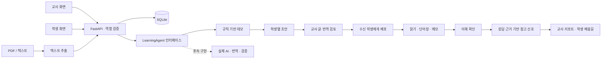
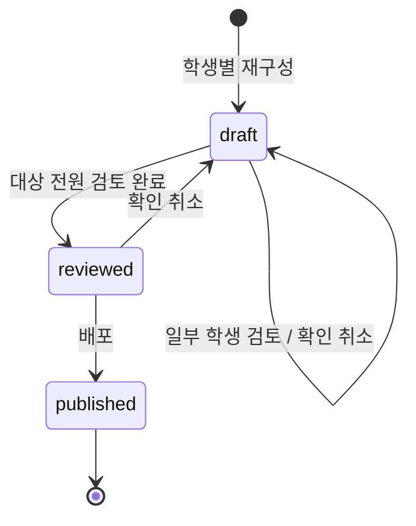

# 이음 아키텍처

## 설계 기준

설계안의 **수업 전 준비 → 수업 중 지원 → 수업 후 확인**을 중심으로 구성했습니다. 교사와 학생은 같은 자료를 바라보되 API가 역할과 수신 학생을 확인합니다. 화면에서 메뉴를 숨기는 것만으로 권한을 구현하지 않습니다.

가칭은 ‘이음’입니다. 계단 로고와 한국어 UI는 외부 이미지·폰트 없이 동작합니다. React/TypeScript/Vite, FastAPI/Pydantic, SQLite를 사용해 외부 서비스 없이 전체 흐름을 실행하고 어댑터와 저장 계층을 확장할 수 있게 했습니다.



## 자료 상태와 검토



- `targets`: 수신 학생 목록.
- `variants`: 학생 ID별 쉬운 글·교과어·언어·단계·개념 카드.
- `reviewed`: 교사가 확인한 학생 목록. 대상 전원과 일치해야 배포됩니다.
- 글·번역 수정과 확인은 함께 저장됩니다. 화면에 미저장 수정이 있으면 배포 버튼을 비활성화합니다.
- 배포본은 수정할 수 없습니다. 후속 버전 관리로 수업·평가 근거를 보존해야 합니다.
- 학생에게는 자신의 수신 자료와 **자신의 variant만** 전달됩니다.

교사 확인은 번역이 객관적으로 검증되었다는 보증이 아닙니다.

## 에이전트 교체 지점

`backend/app/agents.py`:

```python
class LearningAgent(Protocol):
    def reconstruct(self, source: str, level: int, language: str, modes: list[str]) -> dict: ...
    def questions(self, source: str) -> list[dict]: ...
```

현재 `DemoLearningAgent`를 사용합니다. 실제 구현은 출력 구조를 유지하고 `create_app(..., learning_agent=...)`로 주입합니다. 다음 파이프라인은 **후속 구현**입니다.

1. 원문·언어·영역별 수준을 구조화합니다.
2. 원문에 근거한 쉬운 글과 교과어를 생성합니다.
3. 의미 보존·수준 적합성·대역을 검사합니다.
4. 실패 항목을 제한된 횟수로 재생성합니다(Evaluator–Optimizer).
5. 근거와 검토 필요 항목을 교사에게 제공합니다. AI가 검토 완료·배포를 결정하지 않습니다.

입력 문서의 명령문은 모델 지시가 아닌 자료 데이터로 처리해야 합니다. 공급자를 연결할 때 타임아웃·재시도 제한·출처·비용 한도·구조화 출력 검증을 추가하세요.

PDF는 `pypdf`로 텍스트를 추출합니다. 스캔본은 오류와 직접 입력 안내를 반환합니다. OCR 성공이나 이미지 생성을 가장하지 않습니다.

## 평가와 해석

정치 단원 2개 개념을 일반 문장·낮은 언어 부담의 상황 문항으로 각각 확인합니다(총 4개). 예제 원문과 공백 제외 내용이 일치할 때만 고정 문항을 사용합니다. 임의의 정치 키워드만으로 문항을 만들지 않습니다.

- 문항 조회에서 `answer`·`explanation`을 제외합니다.
- 전 문항에 유효한 정수 답을 제출해야 채점됩니다.
- 제출 후 정답·해설을 제공합니다. 재학습용이며 부정행위 방지 시험 시스템은 아닙니다.
- 응답 패턴으로 언어 지원 우선 관찰 / 개념·언어 동시 관찰 / 이번 문항 이해 / 추가 관찰을 제안합니다.
- 응답 없는 학생에게는 **근거 없음**을 표시합니다.
- 생활·학습 한국어 격차만으로 인지 능력이나 개념 이해를 판정하지 않습니다.
- 4문항 규칙은 타당도가 검증되지 않았습니다. 난이도·배경 지식·상황 익숙함도 영향을 줍니다.

단계는 미션에 맞춰 **1~4**로 통일했습니다. 설계안 후반부의 6수준은 미반영입니다. 별도 ‘자료 재구성 기준’·‘학습 한국어 위계’ 탭은 PDF에 없어 상세 루브릭은 후속 입력이 필요합니다.

## 데이터 모델

| 테이블        | 내용                                                |
| ------------- | --------------------------------------------------- |
| `students`    | 합성 이름·언어·학년·영역별 단계·생활 단계·기록 출처 |
| `sessions`    | 무작위 토큰·역할·학생 ID·발급 시각(1일 만료)        |
| `materials`   | 원문·대상·지원 방식·variant·검토·상태               |
| `quizzes`     | 자료별 문항과 서버 전용 정답·해설                   |
| `attempts`    | 학생별 응답·참고 신호·예시 여부·시각                |
| `learning`    | 학생·자료별 메모·아는/더 배울 단어                  |
| `progress`    | 학생·활동별 완료 기록                               |
| `messages`    | 해당 학생과 교사의 내부 대화                        |
| `invitations` | 코드·발급·만료 시각(가입 미연결)                    |

외래 키·SQL 매개변수 바인딩을 사용합니다. 테스트는 임시 DB와 별도 포트를 사용합니다.

## API 경계

| 경로                                                   | 접근·기능                |
| ------------------------------------------------------ | ------------------------ |
| `GET /api/health`, `GET /api/demo`                     | 상태·공개 합성 예시 목록 |
| `POST /api/demo/session`, `GET/DELETE /api/session`    | 데모 입장·세션·퇴장      |
| `GET /api/students`, `POST /api/invitations`           | 교사 학생 목록·초대 코드 |
| `POST /api/diagnostic`                                 | 학생 자가 점검           |
| `POST /api/extract`, `POST /api/materials`             | 교사 입력·생성           |
| `GET /api/materials`, `GET /api/materials/{id}`        | 역할·수신자별 조회       |
| `PATCH /api/materials/{id}/review`, `POST .../publish` | 교사 검토·배포           |
| `GET /api/glossary`, `POST /api/glossary/check`        | 대역표·교사 후보 비교    |
| `POST /api/materials/{id}/quiz`                        | 교사 문항 생성           |
| `GET /api/quizzes`, `GET /api/quizzes/{id}`            | 수신 문항 조회           |
| `POST /api/quizzes/{id}/submit`                        | 학생 제출·채점           |
| `GET /api/reports`                                     | 교사 응답 근거·진행 현황 |
| `GET/PUT /api/learning/{id}`                           | 학생 단어장·메모         |
| `GET /api/roadmap`, `POST /api/roadmap/{id}/complete`  | 추천·활동 확인           |
| `GET/POST /api/messages`                               | 해당 학생 대화           |

요청·응답 스키마는 API 서버의 `/docs`에서 확인합니다.

## 운영 확장 전

사용자가 역할을 고르는 데모 입장은 **신원 인증이 아닙니다**. OIDC 등 인증·학교/학급 권한·감사 이력·보관/삭제 정책이 필요합니다. `IEUM_DEMO_ENABLED=false`는 새 데모 입장만 차단하며 기존 세션이나 운영 인증 문제를 해결하지 않습니다.

HttpOnly·SameSite 쿠키를 쓰며 변경 요청의 Origin과 Host를 비교합니다. 개발 프록시는 Host를 보존합니다. HTTPS에서는 Secure 쿠키를 켜고 운영 reverse proxy도 공개 Host를 올바르게 보존해야 합니다.

파일 파서 격리·시간 제한, 속도 제한, 마이그레이션, 백업, 전문 번역·평가 검수도 후속 범위입니다. SQLite는 해커톤 단일 인스턴스용이며 다중 서버 확장에는 PostgreSQL 등을 고려하세요.
